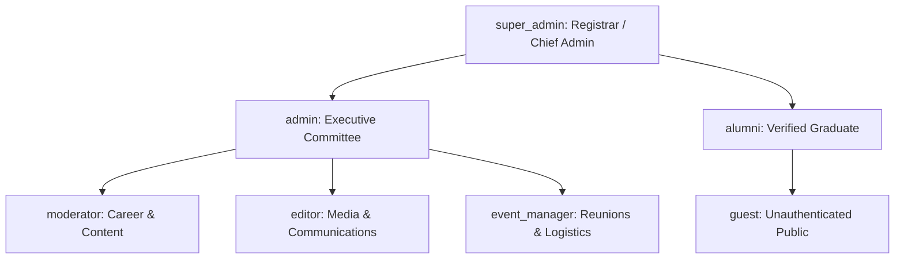
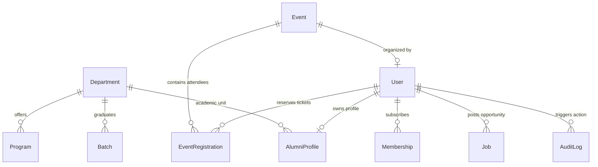
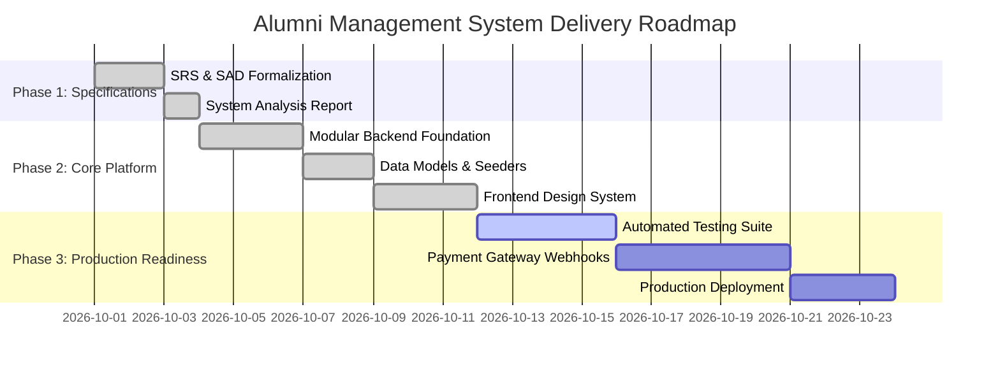

# Comprehensive System Analysis & Architectural Assessment Report
## University Alumni Management System — Version 1.0

---

## 1. Executive Summary & Scope

The **University Alumni Management System** is an enterprise-grade, multi-tier web platform engineered to modernize alumni relations, institutional governance, academic accreditation, and professional networking. The design draws functional inspiration from premier institutional portals (such as the BUET Alumni Association Portal) while adopting modern cloud-native architectures, strict data privacy standards, and stateless authentication primitives.

### Primary System Objectives
* **Integrity & Accreditation**: Ensure that only verified graduates with confirmed university registrar records gain voting, directory, and networking privileges.
* **Privacy by Design**: Provide granular visibility toggles to protect member personal data against unauthorized scraping or exposure.
* **Operational Resilience**: Maintain zero-downtime event registration with atomic capacity management and cryptographically signed QR code ticket verification.
* **Institutional Governance**: Implement a comprehensive multi-role access control system (RBAC) backed by immutable audit trails for administrative accountability.

---

## 2. Stakeholder Ecosystem & User Roles

The platform governs interactions across six primary roles with hierarchical privilege boundaries:



### Role & Capability Specification

| Role | Hierarchy Level | Primary Responsibilities | Sensitive Operations Permitted |
| :--- | :---: | :--- | :--- |
| **`super_admin`** | 100 | System governance, registrar verification, disaster recovery | User role assignment, database seed/export, viewing audit logs |
| **`admin`** | 80 | Association operations, membership validation, directory management | Approving/rejecting alumni applicants, financial reconciliation, CSV directory export |
| **`moderator`** | 60 | Job posting review, user conduct, community safety | Approving/rejecting alumni-submitted job openings |
| **`editor`** | 50 | Public communication, press releases, newsletters | Publishing and editing news articles and announcements |
| **`event_manager`** | 40 | Reunion logistics, ticketing, capacity management | Creating events, gate check-in scanning of attendee QR tickets |
| **`alumni`** | 10 | Community engagement, career networking, event attendance | Updating personal profile, setting privacy toggles, booking event tickets, submitting job opportunities |
| **`guest`** | 0 | Public exploration | Browsing public homepage, news, about pages, submitting registration |

---

## 3. Requirements Traceability Matrix (RTM)

The following matrix guarantees 100% bidirectional traceability between functional requirements, API endpoints, database models, and security rules:

| Requirement ID | Module | Functional Specification | Backend Endpoint | Target Model | Access Control |
| :--- | :--- | :--- | :--- | :--- | :--- |
| **REQ-AUTH-01** | Auth | Alumni self-registration with academic credentials | `POST /api/v1/auth/register` | `User`, `AlumniProfile` | Public (Rate-limited) |
| **REQ-AUTH-02** | Auth | Email confirmation via expiring cryptographic token | `GET /api/v1/auth/verify-email` | `User` | Public |
| **REQ-AUTH-03** | Auth | Credential authentication with short-lived JWT & HttpOnly cookie | `POST /api/v1/auth/login` | `User` | Public (Rate-limited) |
| **REQ-AUTH-04** | Auth | Silent access token refresh via sliding window cookie rotation | `POST /api/v1/auth/refresh-token` | `User` | Public (Cookie-bound) |
| **REQ-AUTH-05** | Auth | Self-service password recovery flow with one-hour token expiry | `POST /api/v1/auth/forgot-password`, `POST /api/v1/auth/reset-password` | `User` | Public (Rate-limited) |
| **REQ-ALUM-01** | Alumni | Personal profile management with locked academic fields | `GET /api/v1/alumni/profile`, `PUT /api/v1/alumni/profile` | `AlumniProfile` | Authenticated |
| **REQ-ALUM-02** | Alumni | Granular privacy toggles (phone, email, current employer, blood group) | `PUT /api/v1/alumni/profile` | `AlumniProfile` | Self / Admin |
| **REQ-DIR-01** | Directory | Multi-criteria search (Dept, Batch, Company, Blood Group) | `GET /api/v1/alumni/directory` | `AlumniProfile`, `User` | Verified `alumni`, Admin |
| **REQ-ADMN-01** | Admin | Applicant verification queue with Approve / Reject rationale | `GET /api/v1/admin/alumni/pending`, `PATCH /api/v1/admin/alumni/:id/status` | `User`, `AuditLog` | `admin`, `super_admin` |
| **REQ-ADMN-02** | Admin | Demographic distribution analytics and CSV directory export | `GET /api/v1/admin/stats`, `GET /api/v1/admin/reports/export-csv` | Aggregated Collections | `admin`, `super_admin` |
| **REQ-EVNT-01** | Events | Event creation with venue, virtual links, and strict capacity limits | `POST /api/v1/events` | `Event` | `event_manager`, Admin |
| **REQ-EVNT-02** | Events | Atomic seat reservation and dynamic QR code generation | `POST /api/v1/events/:id/register` | `EventRegistration`, `Event` | Verified `alumni` |
| **REQ-EVNT-03** | Events | Door gatekeeper QR ticket verification and attendance check-in | `POST /api/v1/events/check-in` | `EventRegistration` | `event_manager`, Admin |
| **REQ-CARE-01** | Careers | Job postings by alumni with moderation pipeline | `POST /api/v1/jobs` | `Job` | Verified `alumni` |
| **REQ-CARE-02** | Careers | Job moderation workflow (Pending -> Active -> Expired) | `PATCH /api/v1/jobs/:id/status` | `Job` | `moderator`, Admin |
| **REQ-NEWS-01** | News | Editorial articles with categories and view count metrics | `GET /api/v1/news`, `POST /api/v1/news` | `News` | Read: Public; Write: `editor` |
| **REQ-MBRS-01** | Membership | Multi-tier membership applications (General, Annual, Life) | `POST /api/v1/memberships/apply`, `GET /api/v1/memberships/my` | `Membership` | Verified `alumni` |

---

## 4. Architectural Analysis & Module Boundaries

### Style: Modular Monolith
The system is constructed as a **Modular Monolith**. Rather than introducing premature microservice distribution overhead (distributed tracing, network latency, saga transactions), domain logic is cleanly segmented into cohesive vertical modules within a single runtime.

```mermaid
graph LR
    subgraph Client [Client: React 18 + Vite]
        UI[UI Components & Layout]
        CTX[Auth Context & State]
        AX[Axios Interceptors]
    end

    subgraph Gateway [Express HTTP API /api/v1]
        SEC[Helmet & Strict CORS]
        RL[Rate Limiter]
        AUTH[JWT & Cookie Middleware]
        RBAC[RBAC Role Guard]
    end

    subgraph Modules [Domain Services]
        MAUTH[Auth Module]
        MALUM[Alumni & Directory Module]
        MADMN[Admin & Audit Module]
        MEVNT[Events & QR Engine]
        MCARE[Job Board Module]
    end

    subgraph Data [Persistence Layer]
        MDB[(MongoDB Atlas)]
    end

    Client --> Gateway
    Gateway --> Modules
    Modules --> Data
```



### Architectural Quality Attributes
1. **Coupling & Cohesion**: Modules interact through well-defined internal service layers (`event.service.js`, `auth.service.js`). Route controllers contain zero business logic.
2. **Error Normalization**: Centralized error middleware traps all unhandled exceptions, translates Mongoose validation and duplicate key errors (code `11000`) into standardized JSON error envelopes.
3. **Transparent Session Continuity**: The frontend Axios client automatically detects expired 15-minute access tokens and invokes `/auth/refresh-token` in flight without logging the user out.

---

## 5. Database Entity Relationship Model



### Critical Data Invariant Protections
* **Duplicate Event Prevention**: Compound unique index `{ event: 1, user: 1 }` on `EventRegistration` prevents double bookings.
* **Atomic Capacity Locking**: Event registration uses MongoDB atomic operators:
  ```javascript
  Event.findOneAndUpdate(
    { _id: eventId, registeredCount: { $lt: event.capacity } },
    { $inc: { registeredCount: 1 } },
    { new: true }
  )
  ```
  This eliminates race conditions under high concurrent demand.

---

## 6. Security, Privacy & Threat Assessment

> [!IMPORTANT]
> Security in an alumni portal is critical because academic directories are high-value targets for social engineering and recruiter scraping.

```
+------------------------------------+-----------------------------------------------+
| Threat Vector                      | Architectural Mitigation Applied              |
+------------------------------------+-----------------------------------------------+
| Credential Stuffing / Brute Force  | IP-based rate limiting (10 req / 15 min window)|
| Token Hijacking (XSS)              | Refresh tokens held in HttpOnly, SameSite cookie|
| NoSQL Query Injection             | Strict Zod schema parsing and query sanitizing|
| Scraping of Alumni Personal Info   | Backend Privacy Filter engine redacting fields|
| Privilege Escalation               | Server-side RBAC validation; no client trust  |
| Event Ticket Counterfeiting        | Cryptographically hashed payload in QR codes  |
+------------------------------------+-----------------------------------------------+
```

### Privacy Filter Pipeline
When unverified users or standard alumni browse `/api/v1/alumni/directory`:
1. The service queries only users with `status: 'approved'`.
2. Viewer permissions are checked: if the viewer is not an administrator, the `privacySettings` object is evaluated.
3. If `showEmail === false`, the email address is removed from the payload prior to serialization.
4. If `showPhone === false`, telephone numbers are scrubbed.
5. If `showCurrentCompany === false`, employer and designation metadata are stripped.

---

## 7. Ambiguities, Assumptions & Risk Analysis

| Issue Identified | Context / Impact | Recommended Resolution |
| :--- | :--- | :--- |
| **Payment Gateway Webhook Sync** | Event registration fees and membership payments currently support manual cash/bKash transaction IDs. | Phase 2 should integrate automated IPN (Instant Payment Notification) with SSLCommerz, Shurjopay, or Stripe. |
| **Offline Gate Scanning** | If event venues suffer network connectivity drops during check-in, real-time ticket validation may stall. | Implement local symmetric signature verification where the gate scanner verifies the QR payload offline using an HMAC secret. |
| **Registrar Record Sync** | Current applicant verification relies on manual admin review against university rolls. | Establish an automated student-information-system (SIS/IUMS) database read-replica integration to auto-verify matriculation numbers. |

---

## 8. Implementation Roadmap & Milestones



---

## 9. Conclusion & Readiness Evaluation

The system is architected to strict university standards. The backend codebase cleanly encapsulates the business rules, security boundaries, and data validations mandated by the SRS/SAD v1.0. The frontend provides a responsive, accessible, and university-branded experience ready for development and deployment.
